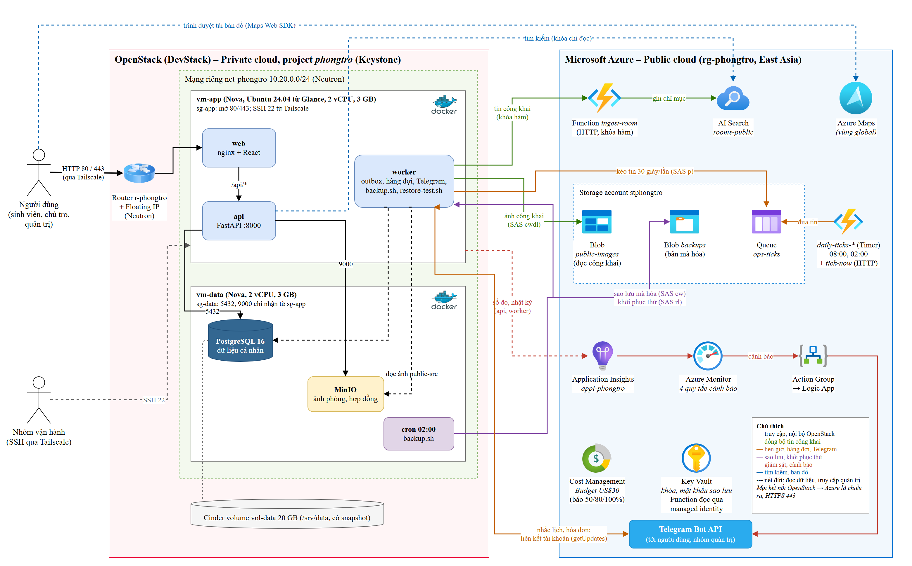

<p align="center"></p>

# EasyRent – Quản lý và tìm phòng trọ cho sinh viên (Azure + OpenStack)

Bài tập lớn môn Điện toán đám mây. Hệ thống hai phía (sinh viên, chủ trọ) chạy trên hai đám mây: dữ liệu cá nhân ở OpenStack (private cloud); tìm kiếm, bản đồ, hẹn giờ, giám sát và sao lưu ở Azure (public cloud).

**Đọc [SPEC.md](SPEC.md) trước khi làm bất cứ việc gì.** Kiến trúc, dữ liệu, API, luồng đồng bộ, quy ước, tiêu chí nghiệm thu và kịch bản kiểm thử đều nằm ở đó.

<p align="center"></p>

Sơ đồ kiến trúc và use case nằm trong [docs/diagrams/](docs/diagrams/) (file `.drawio` sửa được, `.png` để chèn báo cáo; `gen_diagrams.py` vẽ lại).

## Thành viên

| Mã sinh viên | Họ tên | Phụ trách |
|---|---|---|
| 24022772 | Đặng Thế Đạt (nhóm trưởng) | Quản lý, SPEC, dữ liệu mẫu, kiểm thử; Worker, Telegram; sửa lỗi |
| 24022762 | Dương Hoàng Anh | OpenStack (vm-app, vm-data) |
| 24022774 | Nguyễn Tiến Đạt | Frontend |
| 24022766 | Vũ Tuấn Anh | Backend |
| 24022842 | Trịnh Thị Vân | Azure, Azure Functions |
| 24022784 | Phạm Nguyễn Thu Giang | Khung Worker |

Đánh giá thành viên: [docs/danh-gia-thanh-vien.md](docs/danh-gia-thanh-vien.md).

## Bắt đầu trong 5 phút (máy cá nhân)

```bash
cp .env.example .env              # điền DB_PASSWORD, MINIO_ROOT_USER, MINIO_ROOT_PASSWORD, JWT_SECRET, SEED_DEMO_PASSWORD (≥ 8 ký tự, có chữ và số)
docker compose up -d --build      # db + minio + api + worker + web; lần đầu tự nạp schema + 80 phòng dữ liệu giả
docker compose exec api pytest -q # kiểm thử TC01-TC12, các ca báo cáo QA 18/11, sao lưu qua worker
```

Web: http://localhost · API docs: http://localhost:8000/api/docs · MinIO console: http://localhost:9001 · PostgreSQL: localhost:5432.
Tài khoản demo: `admin@example.com`, `chutro1..4@example.com`, `sinhvien1..6@example.com`, mật khẩu là `SEED_DEMO_PASSWORD`.
Chưa cấu hình Azure thì tìm kiếm tự dùng CSDL (header `X-Search-Source: db`) và bản đồ hiện thông báo thiếu khóa.

Chạy worker trên máy cá nhân khi nhóm đã có worker trên VM: chỉ một worker được đọc hàng đợi `ops-ticks` chung, nên worker trên máy cá nhân phải tắt phần đọc hàng đợi bằng `docker-compose.override.yml` (xem [LUU-Y.md](LUU-Y.md) mục 4).

## Có gì trong kho

| Đường dẫn | Nội dung | Người phụ trách |
|---|---|---|
| `SPEC.md` | Đặc tả chung (bản 0.5); `SPECv0.3.md`, `SPECv0.4.md` là bản cũ | Đặng Thế Đạt |
| `LUU-Y.md`, `LUU-Y-SAS.md` | Cách chạy, cổng, bảo mật, thứ tự bật Azure; chuyển worker sang SAS giới hạn quyền | Đặng Thế Đạt |
| `backend/db/schema.sql`, `backend/db/migrations/` | CSDL: 21 bảng, view `v_rooms_public`, hàm chi phí và khoảng cách; thay đổi áp lên CSDL đang chạy | Vũ Tuấn Anh |
| `seed/` | `generate_seed.py` sinh dữ liệu giả tái lập được; `seed.sql` là kết quả | Đặng Thế Đạt |
| `backend/` | API FastAPI – xem [backend/README.md](backend/README.md) | Vũ Tuấn Anh |
| `frontend/` | React + Vite + Tailwind – xem [frontend/README.md](frontend/README.md) | Nguyễn Tiến Đạt |
| `worker/` | Worker: outbox → Azure, hàng đợi `ops-ticks`, Telegram, chạy sao lưu/khôi phục thử, heartbeat và số đo | Phạm Nguyễn Thu Giang, Đặng Thế Đạt |
| `azure-functions/` | `search-index.json`; Function `ingest-room`, `tick-now`, `daily-ticks-morning`, `daily-ticks-backup` | Trịnh Thị Vân |
| `infra/openstack/` | `setup.sh` dựng project, mạng, VM, volume; `cloud-init.yaml` | Dương Hoàng Anh |
| `infra/azure/` | `setup.sh` dựng Storage, AI Search, Maps, Key Vault, App Insights, Function App; `alerts.sh` tạo 4 quy tắc cảnh báo | Trịnh Thị Vân, Đặng Thế Đạt |
| `scripts/` | `backup.sh` (mã hóa, tải lên Blob), `restore-test.sh` (khôi phục thử, đối chiếu) | Phạm Nguyễn Thu Giang |
| `docs/` | Báo cáo kiểm thử QA 18/11, sơ đồ, đánh giá thành viên, nguồn ảnh, ảnh chụp | Cả nhóm |

## Lệnh hay dùng

```bash
# Sinh lại dữ liệu giả (đổi số phòng hoặc seed)
python3 seed/generate_seed.py --rooms 80 > seed/seed.sql
docker compose down -v && docker compose up -d db          # nạp lại từ đầu

# Sao lưu thử không tải lên Azure, rồi khôi phục thử
set -a; . ./.env; set +a
DB_HOST=localhost DRY_RUN=1 BACKUP_DIR=./data/backups scripts/backup.sh
DB_HOST=localhost scripts/restore-test.sh ./data/backups/phongtro-*.tar.gz.enc
```

## Quy tắc ngắn

- `.env` và `.env.*` không bao giờ đưa lên git. Không dán khóa, mật khẩu, token, SAS vào khung chat với AI hay chat nhóm.
- Đổi tên bảng, API, luồng dữ liệu thì sửa `SPEC.md` trước và báo cả nhóm.
- Nhánh `feature/<mô-đun>-<việc>`, commit mỗi ngày, pull request vào `main`, một người khác xem nhanh.
- Toàn bộ dữ liệu là dữ liệu giả. Một chức năng chỉ "xong" khi chạy được trên VM OpenStack hoặc Azure thật.
